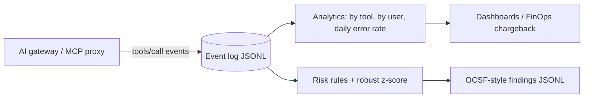

# MCP Tool Usage Analytics (lab)

**Recruiter summary.** Once agents call MCP tools in production, teams need to know who calls what, what it costs, what fails and what looks risky. This lab turns a gateway's tool-call log into per-tool and per-user usage, cost, error and latency analytics, raises risk alerts (volume spikes, off-hours writes/deletes, repeated denials, unregistered tools) and exports them as OCSF-style findings for a SIEM. Detection is scored against injected ground truth on a **synthetic** 7-day log, including one anomaly designed to evade it.

<!-- BEGIN GENERATED -->

**Tests:** 21 passing (`python scripts/count_tests.py`).

**Results** (SYNTHETIC event log; detection scored against injected labels, 6160 events, 30 users, 7 days, seed 11):

| Metric | Value |
|---|---|
| Events | 6160 |
| Users | 30 |
| Distinct tools | 9 |
| Top tool by calls | crm.search_accounts (1605) |
| Illustrative tool cost, 7 days (USD) | 2.3548 |
| erp.get_order error rate, day 4 vs day 3 | 54.3% vs 3.1% |
| Alerts raised | 5 |
| Alerts by rule | offhours_write=1, repeated_denials=1, unregistered_tool=1, volume_spike=2 |
| Alert precision vs injected truth | 5/5 (100.0%) |
| Anomalous user-hours detected (recall) | 4/14 (28.6%) |
| Injected incident types detected | 4/5 (missed: low_and_slow) |
| SIEM records exported (OCSF-style) | 5 |

<!-- END GENERATED -->

**Reading the numbers.** The log is synthetic (fictional distributor *Cobalt Ridge Supply*, 30 users). Precision is high because the injected anomalies are blatant; the low-and-slow case is deliberately subtle and is **missed** by every rule, which is why user-hour recall is low. Costs use illustrative per-call prices.

## Purpose and audience
Platform, SecOps and FinOps engineers running agents with MCP tools; trainees learning tool telemetry and detection engineering.

## Architecture


## How it works
1. `events.py` generates business-hours traffic across 8 tools, a day-4 outage on `erp.get_order`, and five labelled anomaly types.
2. `analytics.by` computes calls, error rate, denials, p50/p95 latency, illustrative cost and MB returned.
3. `risk.detect` (never reads labels; tested) flags volume or byte spikes per user-hour using median/MAD z-scores, off-hours write/delete calls, 10+ denials in an hour, and tools not in the registry.
4. `siem.to_ocsf` maps alerts to a simplified Detection Finding shape.
5. `scripts/run_eval.py` scores alerts against the injected truth.

## Real code and output
```python
detect(ev)[0]
# {'rule': 'volume_spike', 'user': 'u07', 'hour': 86, 'severity': 'high', 'detail': 'calls=... z_calls=... z_bytes=...'}
daily_error_rate(ev, "erp.get_order")[4]   # outage day is clearly visible
```
Full per-tool table: `results/results.json` → `by_tool`.

## How to run
```bash
pip install -r requirements-dev.txt
python scripts/run_eval.py && python scripts/count_tests.py
```
To use real data, emit one JSON line per `tools/call` from your gateway (fields in `events.Event`) and point `by`/`detect` at it.

## Guardrails
Tool registry (unregistered tools are critical), off-hours write/delete alerts, denial-probing alerts, labels kept out of detectors (tested), user ids should be pseudonymised upstream (see gateway repo).

## Limitations and known failures
- Low-and-slow exfiltration is missed (test kept). Needs per-user baselines over weeks and cumulative byte budgets.
- Robust z-score over all users mixes heavy and light users.
- Business hours are a single fixed window; no time zones or holidays.
- OCSF mapping is simplified and not schema-validated.

## Built vs planned
| Item | Status |
|---|---|
| Event model, analytics, 4 risk rules, OCSF export, scoring | Built + tested |
| Per-user seasonal baselines, cumulative byte budgets | Planned |
| Dashboard (Grafana/Workbook JSON) | Planned |

## Docs
[Implementation guide](docs/implementation-guide.md) · [Training](docs/training.md) · [Interview points](docs/interview-points.md) · [Threat model](docs/threat-model.md) · [ADRs](docs/adr/)

## Related repos
Jagadish-ai-gateway-control-plane (event source), Jagadish-agent-trace-observability, Jagadish-azure-ai-soc, Jagadish-token-accounting.

MIT licensed. Lab code.
